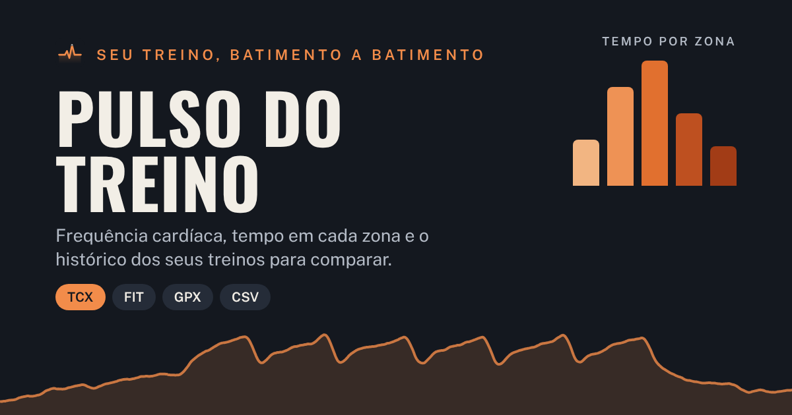

# Pulso do Treino

Aplicativo web para analisar treinos pela frequência cardíaca. Importe o arquivo exportado do relógio
ou do app (TCX, FIT, GPX ou CSV) e veja a curva da FC, o tempo em cada zona, os blocos de esforço, a
recuperação e todos os dados do arquivo. Cada treino fica guardado no histórico, para comparar treinos
entre si. As zonas (Z1 a Z5) são definidas por você na aba **Ajustes**.

Em **Picos e rolas** (ou partidas, no futebol) você dá nome a cada pico de FC e informa quanto tempo
durou cada rola ou partida: o app encontra os trechos dessa duração em que a FC ficou mais alta e
marca cada um no gráfico, com média, máxima e queda da FC no minuto seguinte. O treino também pode
virar uma imagem para compartilhar (Stories, Feed ou Quadrado).

Na aba **Pastas** você cria pastas (por exemplo Jiu-jitsu e Pelada) e coloca os treinos nelas. Cada
pasta mostra os números somados e a FC treino a treino, e dá para importar um arquivo direto para ela.

O **cronômetro** (botão ⏱ no topo) marca as rolas ou partidas durante o treino: você escolhe a duração,
o descanso (fixo ou "até eu tocar", bom para pelada) e quantas serão. Ele toca, vibra e pisca a tela no
começo e no fim de cada uma, mantém a tela acesa e guarda os horários. Quando o arquivo do relógio é
importado, o treino daquele horário já vem com as rolas marcadas nos horários exatos.

No **Histórico** (e em cada pasta) há o calendário de frequência, com os dias de treino e as semanas
seguidas com treino. No topo de cada treino aparece a comparação com o treino anterior da mesma pasta (ou
modalidade); tocar nela abre a comparação completa. Na tela de compartilhar, **Copiar como texto** copia o
resumo do treino para colar no WhatsApp. Ao excluir um treino ou uma pasta, o aviso traz **Desfazer**.

Em treinos com **GPS** (corrida, pedal, caminhada), o percurso aparece num mapa de verdade (OpenStreetMap), colorido
pela zona da FC, pelo ritmo ou pela altitude, com as marcas de cada km e o ponto da FC máxima. Passar o dedo no gráfico da
FC mostra no mapa onde você estava. Há também ritmo médio, tempo em movimento, subida, **parciais por km** e as melhores
marcas do treino (400 m, 1 km, 5 km…). Sem internet, o trajeto é desenhado sem o mapa de fundo.

Cada treino recebe um **esforço de 0 a 21** (no estilo do Whoop, calculado pelo TRIMP), o **foco** (base aeróbica, limiar
ou alta intensidade) e uma **Leitura do treino** que explica os números: comparação com a sua média na modalidade,
recuperação da FC depois do pico, FC subindo ao longo das rolas e o desacoplamento ritmo × FC. Com peso e idade em
**Ajustes**, o app estima as calorias quando o relógio não manda. No **Histórico**, o card **Carga e forma** mostra
condicionamento, fadiga e forma (como no Strava) e a carga da semana comparada às últimas quatro.

**Endereço:** https://guiwemery-pixel.github.io/pulso-do-treino/

## Instalar no celular

- **Android (Chrome):** abra o endereço, toque no menu ⋮ e em **Instalar app** (ou **Adicionar à tela inicial**).
- **iPhone (Safari):** abra o endereço, toque em Compartilhar e em **Adicionar à Tela de Início**.

Depois de instalado, o app abre pelo ícone, em tela cheia, e funciona sem internet.

## Backup

Os treinos ficam guardados no próprio aparelho (no navegador). Em **Ajustes › Backup**, **Fazer backup**
salva um arquivo `.json` com todos os treinos, anotações e zonas (no celular, **Enviar…** manda o arquivo
direto para o Drive, WhatsApp ou e-mail). **Restaurar backup** junta os treinos do arquivo aos que já estão
no aparelho, sem duplicar. O app avisa no Histórico quando há treinos novos fora do backup.

## Publicação

O site é publicado pelo GitHub Pages a partir do branch `main` (pasta raiz): **Settings › Pages › Build
and deployment › Source: Deploy from a branch › `main` / `(root)`**. Cada mudança enviada ao `main`
entra no ar em cerca de um minuto.

## Arquivos

| Arquivo | O que é |
|---|---|
| `index.html` | O aplicativo inteiro (também funciona aberto direto do computador, sem servidor) |
| `manifest.webmanifest`, `sw.js` | Instalação na tela inicial e funcionamento sem internet |
| `icones/` | Ícone do app em vários tamanhos |
| `capa.png` | Capa usada quando o link é compartilhado |
| `.nojekyll` | Faz o GitHub Pages servir os arquivos como estão |
